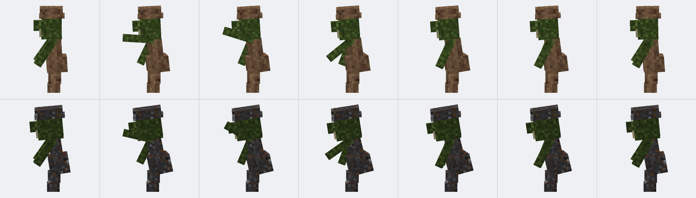

# r148 成年哥布林与首领的普通攻击挥臂

适用：Minecraft 1.21.1 / NeoForge。更新前先备份世界，移走旧版同名 jar，只保留新版。

## 一、为什么以前"挥手臂"看不见

模型里其实早有一段挥臂代码，但它读的是游戏内部的「挥动进度」`attackTime`，
而这个进度在 1.21.1 里**只有一个固定位置会推进**：`Monster.aiStep()`（各种原版怪物）和
`Player.serverAiStep()`（玩家）。

哥布林继承的是 `PathfinderMob`，不在这个名单里。结果就是：哥布林攻击时确实发出了「我在挥」的信号，
但进度计数永远停在 0，模型里那段姿势一帧都算不出来 —— 屏幕上看着就是站桩掉血。

修法是在 `Goblin.aiStep()` 里补一句 `updateSwingTime()`，和原版怪物走同一条路：

```java
@Override
public void aiStep() {
    updateSwingTime();
    super.aiStep();
}
```

同时按体型给了挥动时长：成年哥布林 9 刻、首领 13 刻（原版默认只有 6 刻，短胳膊上快得看不清）。

## 二、动作：抬手 → 下劈 → 收回

原来的曲线照抄原版人形：**一帧抬到顶、五帧慢慢落回**，在哥布林这种短胳膊上几乎是抖一下。
现在改成三段关键帧（`GoblinModel` 里的 `SWING_TIMES` / `SWING_VALUES`）：

| 进度 | 姿势 |
| --- | --- |
| 0 → 30% | 抬手：武器举到身前偏上，躯干微微拧出去 |
| 30% → 46% | 下劈：手臂甩到身前下方，腰往前压 |
| 46% → 100% | 收回：回到备战姿势 |

配套的细节：

- **主手是哪只手就挥哪只**，副手往后收一下当配重，不会两只手一起舞；
- 腰拧 0.16 弧度、身前倾、头往下点，动作不是一个胳膊在单独动；
- **首领幅度更大**（1.75 对 1.40 弧度），配合更慢的 13 刻，看起来更沉；
- 正在放技能（战吼 / 跳劈 / 蓄力斩击）、施法、拉弓时不叠普通攻击，两套姿势不会打架。

## 三、自检

- `tools/check_goblin_poses.py`：直接跑真实的 `GoblinModel` 代码，把 `attackTime` 从 0 扫到 1，
  检查五种体型 × 左右手共 10 组：主手要抬得起来（峰值低于 -1.35 弧度）、另一只手不能跟着乱挥、
  挥完要回到站姿。全部通过。
- `tools/preview_goblin_swing.py`：把同一套曲线搬到可编辑模型上抽 7 帧渲染，
  上排成年战士、下排首领，用来看动作读不读得出来。



以上是代码与离线渲染验证，不代表已在整套模组环境里完成实机复测。
